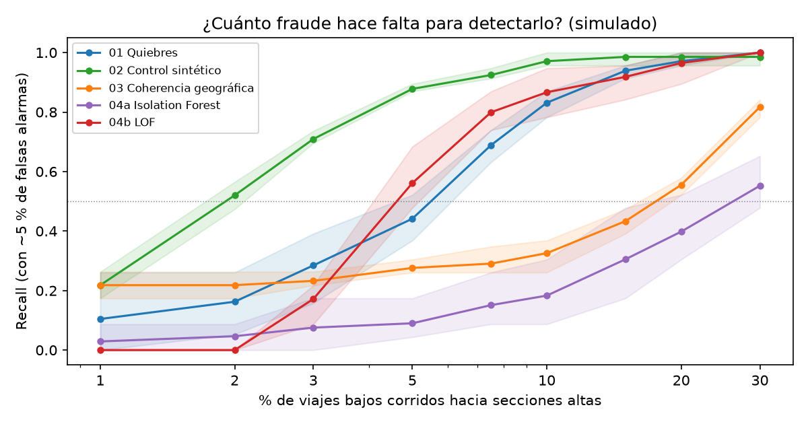

# Detección de anomalías tarifarias en colectivos (AMBA) con datos SUBE

Un caso práctico, reproducible y didáctico de **cómo se detectarían anomalías de cobro de secciones tarifarias** en el sistema de colectivos del AMBA.
Está pensado para el curso de *Data Science para Politólogos*, como proyecto de portfolio y como material de divulgación.

## Encuadre (leer primero)

- El proyecto se inspira en una **causa judicial abierta** (nota de [Infobae, 13/10/2026](https://www.infobae.com/judiciales/2026/10/13/avanza-una-investigacion-por-cobrar-de-mas-a-pasajeros-de-colectivos-que-incluye-un-presunto-fraude-en-subsidios/)).
  **No se acusa a ninguna empresa.** Este repositorio demuestra *métodos*; no hace afirmaciones sobre hechos.
- **El fraude de este repositorio es simulado.** Los datos públicos no traen secciones tarifarias ni montos cobrados (ver [`docs/fuentes.md`](docs/fuentes.md)),
  así que esa capa se inventa. Las líneas y empresas de la simulación están **anonimizadas** (`L001`, `E001`) y mezcladas al azar:
  ningún resultado se puede leer como referido a una empresa real.
- Con datos reales, cualquier hallazgo se presentaría como una **"anomalía a revisar"**, nunca como prueba de fraude.
- Foco técnico, no comentario político.

## La pregunta

Según la denuncia, se instruía a choferes a marcar secciones tarifarias mayores a las del recorrido real. Como los subsidios son una **suma fija repartida entre empresas**,
inflar la recaudación aumenta la porción de una empresa a costa de las demás. ¿Cómo se vería eso en los datos, y qué tan chico puede ser un fraude para que se pueda detectar?

## Qué hace

1. **Fase 0-1, datos reales:** panel de ~390 líneas de colectivo × mes (SUBE, 2020-2026), con geografía de los recorridos (largo, distancia al centro) y grupos de líneas comparables.
2. **Fase 2, simulación:** se simula cómo se reparten los viajes entre las 5 secciones tarifarias y se **planta un fraude** (≈9 % de las líneas, de 18 empresas, desde enero de 2026): una fracción de los viajes de secciones bajas se cobra más arriba. También se simula el reparto de una bolsa fija de subsidios.
3. **Fase 3, cinco métodos de detección** (un notebook por método).
4. **Fase 4, evaluación:** todos los métodos con el mismo protocolo, y un barrido de sensibilidad sobre la magnitud del fraude.

| Método | Idea | Notebook |
|---|---|---|
| 01 Quiebres | ¿Cambió el nivel de la tarifa media de la línea? (`ruptures`) | [`01_changepoints`](notebooks/01_changepoints.ipynb) |
| 02 Control sintético / DiD | ¿Cuánto se despegó de lo que habría hecho sin el cambio? Estima el monto | [`02_did_control_sintetico`](notebooks/02_did_control_sintetico.ipynb) |
| 03 Coherencia geográfica | ¿Lo cobrado es plausible para el largo del recorrido? | [`03_coherencia_geografica`](notebooks/03_coherencia_geografica.ipynb) |
| 04 Anomalías ML | Isolation Forest y LOF, sin ninguna idea previa sobre el fraude | [`04_anomalias_ml`](notebooks/04_anomalias_ml.ipynb) |
| 05 Inferencia de la bajada | Con microdatos simulados de validaciones, infiere dónde bajó cada tarjeta y compara con la sección cobrada | [`05_inferencia_bajada`](notebooks/05_inferencia_bajada.ipynb) |

## Resultados (todo simulado)

Protocolo unificado: todos deciden con datos hasta junio de 2026, calibran su umbral con un *placebo* sin fraude para marcar ~5 % de líneas inocentes, y se evalúan contra la misma verdad.
Barrido: 9 magnitudes × 3 semillas. Detalle en [`06_evaluacion_comparativa`](notebooks/06_evaluacion_comparativa.ipynb).

**Caso base (20 % de viajes bajos corridos; la tarifa media sube ≈ 2,8 %).** Líneas evaluables por todos los métodos: 270, de las cuales 19 con fraude:

| Método | Recall | Precisión | Falsas alarmas | AUC | Cobertura del método |
|---|---|---|---|---|---|
| 01 Quiebres | 100 % | 44 % | 9,6 % | 0,997 | 100 % |
| 02 Control sintético | 100 % | 50 % | 7,6 % | 1,000 | 73 % |
| 03 Coherencia geográfica | 58 % | 73 % | 1,6 % | 0,936 | 58 % |
| 04a Isolation Forest | 37 % | 28 % | 7,2 % | 0,912 | 27 % |
| 04b LOF | 89 % | 77 % | 2,0 % | 0,966 | 85 % |

*Cobertura = qué parte de **todas** las líneas con fraude logra detectar cada método (el 02 no puede evaluar líneas con poca historia).*
*El umbral de cada método apunta a ~5 % de falsas alarmas, pero la calibración no es pareja: en el barrido completo el 01 promedia 9,5 %, el 02 5,1 %, el 03 4,6 %, Isolation Forest 6,5 % y LOF 0,5 %.*

**¿Cuánto fraude hace falta para detectarlo?** (recall promedio de 3 simulaciones ≥ 50 % / ≥ 80 %)

| Método | ≥ 50 % | ≥ 80 % |
|---|---|---|
| 02 Control sintético | 2 % de viajes corridos (tarifa media +0,3 %) | 5 % (+0,7 %) |
| 04b LOF | 5 % (+0,7 %) | 10 % (+1,4 %) |
| 01 Quiebres | 7,5 % (+1,0 %) | 10 % (+1,4 %) |
| 03 Coherencia geográfica | 20 % (+2,8 %) | 30 % (+4,1 %) |
| 04a Isolation Forest | 30 % (+4,1 %) | no se alcanza |



**Método 05 (aparte, otra simulación):** con microdatos de validaciones de 24 líneas ficticias (6 con fraude), inferir la bajada detecta el 57 % de las líneas con fraude cuando se corre el 2 % de los viajes,
contra 3 % si solo se mira la tarifa media, y con 0 falsas alarmas en 3.780 líneas inocentes (regla de Bonferroni). La ventaja es robusta pero su tamaño depende de supuestos de la simulación;
es una **cota optimista** (cada tarjeta usa una sola línea, sin trasbordos). Los números no son comparables uno a uno con la tabla de arriba.

**Lo que se aprende:**
- **El control sintético es el más sensible**, pero no puede evaluar líneas con poca historia: su recall sobre todas las líneas con fraude se frena en ≈ 78 %. Con fraudes grandes lo superan el 01 y LOF.
- **El 01 parece muy bueno (recall alto) pero acusa de más:** casi 1 de cada 10 líneas inocentes. Comparar métodos solo por recall engaña; hay que mirar falsas alarmas y cobertura.
- **Un detector genérico no es todo igual:** Isolation Forest rinde mal, mientras que LOF compite con los métodos específicos, aunque su calibración es errática.
- **La sección máxima, tal como se planteaba al inicio, no sirve** si el fraude infla una o dos secciones (AUC 0,45).
- **Un fraude muy chico escapa a casi todo:** con menos de ≈ 0,7 % de aumento de la tarifa media, solo el control sintético supera la mitad de las líneas.
- **Medir directamente supera a deducir:** si se pudiera inferir la bajada (hacen falta microdatos, hoy no públicos), el fraude se vería con bastante menos magnitud.
- **El perjuicio se puede estimar, con cuidado:** en el caso base del notebook 02, el control sintético estima el sobrecobro con un error de −1,6 % sobre las líneas que detecta, pero **subestima el total en ≈ 30 %** por las líneas que no puede evaluar.

## Limitaciones

- **Todo depende de la simulación.** No hay shocks propios de cada línea (cambios de recorrido, obras, paros), ni deriva de la demanda. Con datos reales las falsas alarmas serían mayores y el recall menor: estos números son una cota optimista.
- **La distribución de distancias de viaje es un supuesto** (lognormal truncada al largo del recorrido), **no calibrada** con la matriz OD de GCBA: no se pudo ubicar el archivo de datos, solo su metadato. Las tarifas relativas por sección y la regla de reparto de la bolsa también son ilustrativas.
- **El método 05 es el más optimista:** modelo unidimensional, sin trasbordos ni recorridos que se crucen.
- **Un solo tipo de fraude** (corrimiento fijo desde una fecha). Uno gradual, intermitente o concentrado podría comportarse distinto.
- **Pocas semillas** (3): la banda mín-máx indica variabilidad, no es un intervalo de confianza.
- **Los métodos no son independientes** (el 02 usa al 01 para depurar donantes) y comparten el supuesto de que el pasado es limpio.
- Detalle de decisiones tomadas después de ver resultados (por ejemplo, umbrales ajustados en el método 02) y errores corregidos en el camino: están documentados en cada notebook.

## Desidentificación y reproducibilidad

Como el proyecto planta un fraude **simulado** sobre líneas que existen, se tomaron medidas para que nada pueda leerse como una afirmación sobre una empresa real:

- Líneas y empresas se reemplazan por identificadores ficticios (`L001`, `E001`) en orden aleatorio.
- **La asignación del fraude y el mapeo a los identificadores dependen de una sal secreta** (variable de entorno `FRAUDE_SUBE_SAL` o archivo `.sal`, que **no se versiona**).
  Sin esa sal no se puede reconstruir qué líneas reales recibieron el fraude simulado.
- A cada línea se le aplica un factor secreto de escala sobre sus viajes y un pequeño ruido sobre el largo del recorrido y la distancia al centro, para que los valores que se muestran no coincidan con los de los datos públicos.
- Los notebooks no muestran nombres reales de empresas ni de líneas.

**Consecuencia:** quien ejecute el código obtiene **su propia asignación** del fraude, así que sus números serán parecidos pero **no idénticos** a los de este README. Las conclusiones cualitativas deberían sostenerse; si no, es un hallazgo sobre la robustez del método. Esto es una medida razonable, no una garantía: una línea que arranca o termina en un mes muy particular podría ser más fácil de reconocer.

## Reproducir

Requiere Python 3.13 (se desarrolló con 3.13, aunque el diseño original preveía 3.12). Descarga ≈ 400 MB.

```bash
python -m venv .venv && source .venv/bin/activate
pip install -r requirements.txt

python src/download.py            # fuentes públicas -> data/raw/ (no versionado)
cd src
python build_base.py              # panel real + geografía + grupos   -> data/processed/
python build_sim.py               # secciones simuladas + fraude      -> data/processed/
python barrido.py                 # barrido de sensibilidad (~25 min) -> data/processed/barrido.parquet
cd ..
```

Luego ejecutar los notebooks **en orden**: `00_exploracion`, `00b_panel_base`, `00c_simulacion_secciones`, `01_changepoints`, `02_did_control_sintetico`,
`03_coherencia_geografica`, `04_anomalias_ml`, `05_inferencia_bajada`, `06_evaluacion_comparativa` (el 02 lee la salida del 01; el 03 la del 02; el 06 la del barrido).

### Con Docker

Las versiones exactas de las librerías están en `requirements.lock`. Los datos y las salidas se montan como volúmenes (no van dentro de la imagen):

```bash
docker build -t fraude-sube .
docker run --rm -v "$PWD/data:/app/data" -v "$PWD/outputs:/app/outputs" -v "$PWD/notebooks:/app/notebooks" fraude-sube
# más rápido, sin el barrido de sensibilidad ni el notebook 06:
docker run --rm -e SKIP_BARRIDO=1 -v "$PWD/data:/app/data" -v "$PWD/outputs:/app/outputs" -v "$PWD/notebooks:/app/notebooks" fraude-sube
```

Dentro del contenedor cada ejecución genera su propia sal secreta (ver *Desidentificación*). Para repetir una misma asignación, pasá `-e FRAUDE_SUBE_SAL=<un texto cualquiera>`; esa sal no se publica.

Parámetros de la simulación (magnitud del fraude, fecha de inicio, proporción de líneas, semilla) en [`config.yaml`](config.yaml).

## Estructura

```
config.yaml            parámetros de la simulación (todos son supuestos)
Dockerfile, scripts/   entorno reproducible y script que corre todo el pipeline
src/                   lógica reutilizable (carga, panel, simulación, métodos, evaluación)
notebooks/             un notebook por etapa y por método, en español
outputs/figures/       gráficos listos para reutilizar
docs/fuentes.md        hallazgos sobre las fuentes de datos
docs/pedido_acceso.md  borrador de pedido de acceso a la información pública (Ley 27.275)
```

## Datos

- Transacciones SUBE por día (2020-2026), recorridos de líneas RMBA (shapefiles), operaciones de viaje 2013-2019: Secretaría de Transporte, [datos.gob.ar](https://datos.gob.ar) y [datos.transporte.gob.ar](https://datos.transporte.gob.ar).
- **Lo que no es público** (y motivó la simulación): recaudación por línea, viajes por sección tarifaria, microdatos de validaciones con monto cobrado. El borrador [`docs/pedido_acceso.md`](docs/pedido_acceso.md) propone cómo pedirlo.

## Licencia

- **Código** (`src/`, `scripts/`, `Dockerfile`, celdas de código de los notebooks): [MIT](LICENSE).
- **Textos, documentación y gráficos**: [CC BY 4.0](LICENSE-CONTENIDO.md). Citar como: Stillo, J. F. (2026). *Detección de anomalías tarifarias en colectivos del AMBA con datos SUBE* (material didáctico con datos simulados).
- Los datos públicos que se descargan pertenecen a sus fuentes y no se redistribuyen acá.
